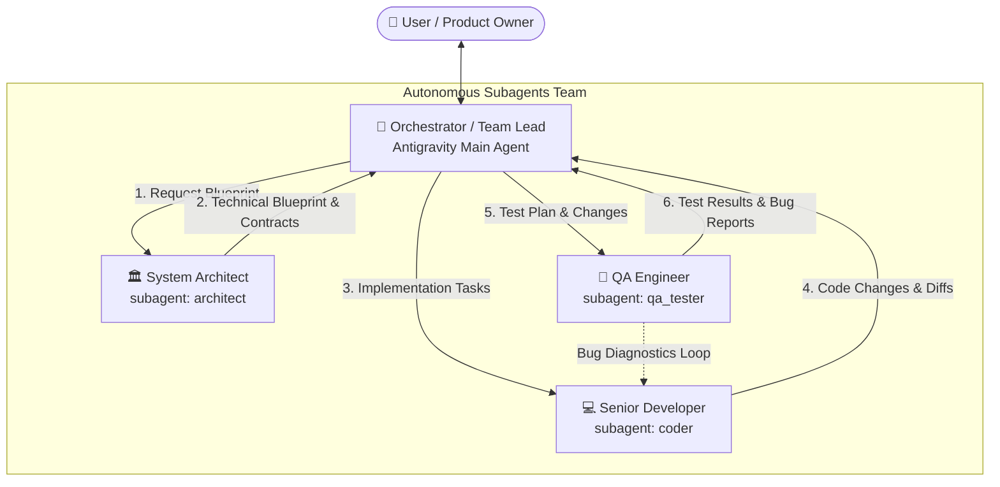

# Multi-Agent Engineering Team Architecture (ІП-66 Bot)

This document establishes the autonomous multi-agent hierarchy, roles, and execution protocols for development, maintenance, and testing in this repository.

---

## 1. Team Hierarchy & Roles

### 🎯 1. Orchestrator (Antigravity Main Agent)
- **Role**: Team Lead, Project Manager, Central Coordinator.
- **Responsibilities**:
  - Communicates directly with the user.
  - Translates user requirements into clear milestones and sub-tasks.
  - Invokes specialized subagents (`architect`, `coder`, `qa_tester`) and orchestrates the pipeline.
  - Aggregates results, resolves conflicts, verifies test passes, and delivers concise summaries to the user.

### 🏛️ 2. System Architect (`architect`)
- **Role**: System Design, Contracts & Risk Analysis.
- **Responsibilities**:
  - Researches codebase structure, database models, state machines, and API endpoints.
  - Produces structured **Technical Blueprints**:
    - Data flow & state transitions.
    - Database schema & API contracts.
    - Implementation task list for the Coder.
    - Edge cases & boundary checklist for the Tester.
  - Protects architectural integrity and backwards compatibility.

### 💻 3. Senior Developer / Coder (`coder`)
- **Role**: Software Implementation & Engineering.
- **Responsibilities**:
  - Implements clean, maintainable, production-ready code strictly adhering to the Architect's Blueprint.
  - Maintains existing codebase style, async patterns, and documentation integrity (preserves unrelated comments and docstrings).
  - Minimizes blast radius: changes only what is necessary, ensuring existing features do not break.
  - Reports detailed list of modified/created files and logical changes back to the Orchestrator.

### 🧪 4. QA Engineer / Tester (`qa_tester`)
- **Role**: Quality Assurance, Automated Testing & Bug Hunting.
- **Responsibilities**:
  - Formulates automated test plans for both positive flows and edge cases (concurrency, priority drops, network drops, etc.).
  - Writes automated test files (Python `unittest`/`pytest`, Node.js UI simulation scripts).
  - Executes tests directly via terminal commands (`run_command`), inspects execution logs, and verifies zero failures.
  - If tests fail, provides reproducible diagnostic reports with stack traces and root cause analysis for the Coder.

---

## 2. Standard Execution Lifecycle

For any non-trivial feature, bug fix, or refactoring:

1. **Phase 1: Architecture & Design (`architect`)**
   - The Orchestrator delegates requirement analysis to the `architect`.
   - The Architect inspects files and returns the Blueprint and risk assessment.
2. **Phase 2: Implementation (`coder`)**
   - The Orchestrator reviews the Blueprint and assigns implementation tasks to the `coder`.
   - The Coder writes/edits files, checks syntax, and reports completed work.
3. **Phase 3: QA & Verification (`qa_tester`)**
   - The Orchestrator delegates test creation and execution to `qa_tester`.
   - The QA Engineer writes and executes tests in terminal (`py -m unittest ...`, `node test_...`).
   - If a failure is found, the Coder fixes the issue until all tests pass (`OK`).
4. **Phase 4: Release & User Delivery (Orchestrator)**
   - The Orchestrator verifies git status, ensures working tree cleanliness, and presents the final concise result to the user.

---

## 3. Subagents Roster & Invocation

| Subagent Name | Role | Primary Tools | Execution Context |
| :--- | :--- | :--- | :--- |
| `architect` | System Architect | `read_file`, `run_command`, `search_web` | Code exploration, RFC / Blueprint creation |
| `coder` | Senior Implementer | `write_file`, `edit_file`, `read_file`, `run_command` | Production code changes, bug fixing |
| `qa_tester` | QA Test Specialist | `run_command`, `write_file`, `edit_file`, `read_file` | Automated tests writing & execution |
